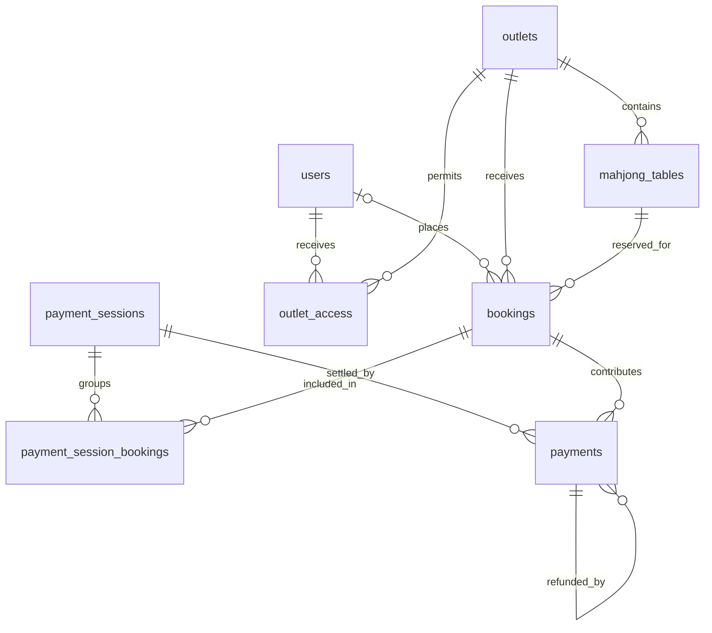

# Database design

## Status and scope

This PostgreSQL schema is encoded in the TypeORM migrations under [`src/database/migrations`](src/database/migrations). The backend uses NestJS/TypeORM with `synchronize: false`; apply migrations explicitly before connecting the frontend. Public guests can book public outlets without an account; private outlets require a signed-in customer with a live outlet grant. Checkout holds and DOKU payment status are persisted server-side.

## Relationships



| Table                                    | Purpose and important columns                                                                                                                                                                                                                                                                                                                                                                                                                                              |
| ---------------------------------------- | -------------------------------------------------------------------------------------------------------------------------------------------------------------------------------------------------------------------------------------------------------------------------------------------------------------------------------------------------------------------------------------------------------------------------------------------------------------------------- |
| `users`                                  | `id` UUID PK; `auth_subject` unique trusted identifier; `email` unique case-insensitively; nullable `password_hash` bcrypt digest for provisioned dashboard owners; `role` (`customer`, `owner`); `is_active`, audit timestamps. Dashboard credentials are provisioned only by trusted administrators; never store session tokens in this table.                                                                                                                           |
| `outlets`                                | `id` UUID PK; `name` and `city` varchar(80); `address` varchar(240); `timezone` IANA name (default `Asia/Jakarta`); positive `hourly_rate_idr` and JSONB `rate_tiers` shared by all tables at the outlet; `is_active` boolean; `visibility` (`public`, `private`); `archived_at`, `created_at`, `updated_at` timestamptz. Active names are unique case-insensitively. |
| `mahjong_tables`                         | `id` UUID PK; `outlet_id` FK; `name` varchar(80), `condition` (`available`, `maintenance`), `archived_at`, audit timestamps. Active table names are unique within an outlet. There is no manually editable `in_use` flag: it is derived from an `in_progress` booking. |
| `bookings`                               | `id` UUID PK; nullable `user_id` FK for an authenticated customer (guest bookings have no user); `outlet_id` and `table_id` (joint FK to the table's outlet); public `reference` unique; `customer_name`, `customer_contact`; `starts_at`, `ends_at` UTC instants; `duration_hours`; `hourly_rate_idr` and `total_amount_idr` price snapshots; `status` (`pending`, `confirmed`, `in_progress`, `completed`, `cancelled`, `expired`); `hold_expires_at`, audit timestamps. |
| `payment_sessions`                       | Merchant invoice number, DOKU environment, aggregate amount/status, checkout URL, 15-minute provider expiry, notification request ID, and guest name/phone/email. One order can contain multiple booking rows.                                                                                                                                                                                                                                                             |
| `payment_session_bookings`               | Composite-key links from one checkout session to its held bookings; each booking belongs to at most one payment session.                                                                                                                                                                                                                                                                                                                                                   |
| `payments`                               | `id` UUID PK; `booking_id` FK; nullable `payment_session_id` FK; `kind` (`charge`, `refund`), `status` (`pending`, `succeeded`, `failed`); `amount_idr`; `provider`, `provider_reference`, `idempotency_key`; `original_payment_id` for refunds; `settled_at`, audit timestamps. One row per booking contribution to the aggregate charge or refund.                                                                                                                       |
| `outlet_access`                          | Composite `(outlet_id, user_id)` key grants one customer access to one outlet, optionally until `expires_at`. Removing a grant blocks new private bookings but preserves existing reservations.                                                                                                                                                                                                                                                                            |
| `customer_otp`, `customer_otp_ip_limits` | Hashed, single-use email challenges with persistent email and IP rate limits. Codes are delivered only to active customer accounts with a current grant to an active, non-archived outlet. |

All money is **whole Indonesian rupiah (IDR)** stored as `bigint`; never floating point. Identifiers remain stable across renames. All timestamps are `timestamptz`, stored as instants; use an outlet's `timezone` only for displaying and grouping local calendar dates. No precomputed dashboard totals or independent transaction table is required: successful payment rows are the financial source of truth.

The private-access migration adds `outlets.visibility` (`public` by default) so
existing locations stay discoverable. Outlet operation (`is_active`) and
visibility are independent. Public discovery and checkout enforce the same
active, unarchived, grant-not-expired rule for private locations.

The `MovePricingToOutlets1792108800000` migration checks that every table
within each outlet has the same legacy hourly rate. It transfers that rate
to the outlet, creates empty outlet-level duration tiers, defaults empty
outlets to Rp75,000 per hour, and drops `mahjong_tables.hourly_rate_idr`.
Conflicting legacy rates must be reconciled before migration; existing
booking `hourly_rate_idr` and `total_amount_idr` snapshots are unchanged.

## Proposed migration DDL

The following DDL describes the initial TypeORM migration; **do not run this SQL separately** if using the migration. PostgreSQL's `btree_gist` extension provides the overlapping-booking exclusion rule. The example uses `gen_random_uuid()` (available in supported PostgreSQL versions); if the target server does not expose it, enable `pgcrypto` in the migration. Confirm extension privileges in the deployment environment. The migration rollback drops only its tables in reverse dependency order and leaves `btree_gist` installed, since it may have existed before or be used elsewhere.

```sql
CREATE EXTENSION IF NOT EXISTS btree_gist;

CREATE TABLE users (
  id uuid PRIMARY KEY DEFAULT gen_random_uuid(),
  auth_subject varchar(160) NOT NULL UNIQUE,
  email varchar(254) NOT NULL,
  role varchar(10) NOT NULL DEFAULT 'customer'
    CHECK (role IN ('customer', 'owner')),
  is_active boolean NOT NULL DEFAULT true,
  created_at timestamptz NOT NULL DEFAULT now(),
  updated_at timestamptz NOT NULL DEFAULT now()
);
CREATE UNIQUE INDEX users_email_uq ON users (lower(btrim(email)));

CREATE TABLE outlets (
  id uuid PRIMARY KEY DEFAULT gen_random_uuid(),
  name varchar(80) NOT NULL CHECK (length(btrim(name)) > 0),
  city varchar(80) NOT NULL CHECK (length(btrim(city)) > 0),
  address varchar(240) NOT NULL CHECK (length(btrim(address)) > 0),
  timezone varchar(64) NOT NULL DEFAULT 'Asia/Jakarta',
  is_active boolean NOT NULL DEFAULT true,
  archived_at timestamptz,
  created_at timestamptz NOT NULL DEFAULT now(),
  updated_at timestamptz NOT NULL DEFAULT now()
);
CREATE UNIQUE INDEX outlets_active_name_uq
  ON outlets (lower(btrim(name))) WHERE archived_at IS NULL;

CREATE TABLE mahjong_tables (
  id uuid PRIMARY KEY DEFAULT gen_random_uuid(),
  outlet_id uuid NOT NULL REFERENCES outlets(id) ON DELETE RESTRICT,
  name varchar(80) NOT NULL CHECK (length(btrim(name)) > 0),
  hourly_rate_idr bigint NOT NULL CHECK (hourly_rate_idr > 0),
  condition varchar(20) NOT NULL DEFAULT 'available'
    CHECK (condition IN ('available', 'maintenance')),
  archived_at timestamptz,
  created_at timestamptz NOT NULL DEFAULT now(),
  updated_at timestamptz NOT NULL DEFAULT now(),
  UNIQUE (id, outlet_id)
);
CREATE UNIQUE INDEX tables_active_name_per_outlet_uq
  ON mahjong_tables (outlet_id, lower(btrim(name))) WHERE archived_at IS NULL;
CREATE INDEX tables_outlet_idx ON mahjong_tables (outlet_id);

CREATE TABLE bookings (
  id uuid PRIMARY KEY DEFAULT gen_random_uuid(),
  reference varchar(40) NOT NULL UNIQUE,
  outlet_id uuid NOT NULL REFERENCES outlets(id) ON DELETE RESTRICT,
  table_id uuid NOT NULL,
  user_id uuid REFERENCES users(id) ON DELETE SET NULL,
  customer_name varchar(120) NOT NULL CHECK (length(btrim(customer_name)) > 0),
  customer_contact varchar(160) NOT NULL CHECK (length(btrim(customer_contact)) > 0),
  starts_at timestamptz NOT NULL,
  ends_at timestamptz NOT NULL,
  duration_hours integer NOT NULL CHECK (duration_hours > 0),
  hourly_rate_idr bigint NOT NULL CHECK (hourly_rate_idr > 0),
  total_amount_idr bigint NOT NULL CHECK (total_amount_idr > 0),
  status varchar(20) NOT NULL CHECK (status IN
    ('pending', 'confirmed', 'in_progress', 'completed', 'cancelled', 'expired')),
  hold_expires_at timestamptz,
  created_at timestamptz NOT NULL DEFAULT now(),
  updated_at timestamptz NOT NULL DEFAULT now(),
  CONSTRAINT bookings_table_outlet_fk FOREIGN KEY (table_id, outlet_id)
    REFERENCES mahjong_tables(id, outlet_id) ON DELETE RESTRICT,
  CONSTRAINT bookings_times_ck CHECK (ends_at > starts_at),
  CONSTRAINT bookings_duration_ck CHECK
    (EXTRACT(EPOCH FROM ends_at - starts_at) = duration_hours * 3600),
  CONSTRAINT bookings_total_ck CHECK
    (total_amount_idr = hourly_rate_idr * duration_hours),
  CONSTRAINT bookings_pending_hold_ck CHECK
    (status <> 'pending' OR
      (hold_expires_at IS NOT NULL AND hold_expires_at > created_at))
);
-- Half-open ranges allow one booking to end when the next starts.
-- Pending payment holds also reserve the slot until changed to expired/cancelled.
ALTER TABLE bookings ADD CONSTRAINT bookings_no_overlap
  EXCLUDE USING gist (
    table_id WITH =,
    tstzrange(starts_at, ends_at, '[)') WITH &&
  ) WHERE (status IN ('pending', 'confirmed', 'in_progress'));
CREATE INDEX bookings_outlet_start_idx ON bookings (outlet_id, starts_at);
CREATE INDEX bookings_table_start_idx ON bookings (table_id, starts_at);
CREATE INDEX bookings_pending_expiry_idx ON bookings (hold_expires_at)
  WHERE status = 'pending';

CREATE TABLE payments (
  id uuid PRIMARY KEY DEFAULT gen_random_uuid(),
  booking_id uuid NOT NULL REFERENCES bookings(id) ON DELETE RESTRICT,
  kind varchar(10) NOT NULL CHECK (kind IN ('charge', 'refund')),
  status varchar(10) NOT NULL CHECK (status IN ('pending', 'succeeded', 'failed')),
  amount_idr bigint NOT NULL CHECK (amount_idr > 0),
  provider varchar(80) NOT NULL CHECK (length(btrim(provider)) > 0),
  provider_reference varchar(160),
  idempotency_key varchar(160) NOT NULL UNIQUE,
  original_payment_id uuid,
  settled_at timestamptz,
  created_at timestamptz NOT NULL DEFAULT now(),
  updated_at timestamptz NOT NULL DEFAULT now(),
  UNIQUE (id, booking_id),
  CONSTRAINT payments_refund_parent_fk FOREIGN KEY (original_payment_id, booking_id)
    REFERENCES payments(id, booking_id) ON DELETE RESTRICT,
  CONSTRAINT payments_refund_parent_ck CHECK
    ((kind = 'refund') = (original_payment_id IS NOT NULL)),
  CONSTRAINT payments_settlement_ck CHECK
    ((status = 'succeeded') = (settled_at IS NOT NULL))
);
CREATE UNIQUE INDEX payments_provider_reference_uq
  ON payments (provider, provider_reference) WHERE provider_reference IS NOT NULL;
CREATE INDEX payments_booking_idx ON payments (booking_id);
CREATE INDEX payments_settled_idx ON payments (settled_at, booking_id)
  WHERE status = 'succeeded';

```

The DOKU migration creates an aggregate order and links each booking contribution to the existing `payments` table:

```sql
CREATE TABLE payment_sessions (
  id uuid PRIMARY KEY DEFAULT gen_random_uuid(),
  invoice_number varchar(30) NOT NULL UNIQUE,
  environment varchar(10) NOT NULL CHECK (environment IN ('dev', 'prod')),
  status varchar(20) NOT NULL CHECK (status IN ('pending', 'succeeded', 'failed', 'expired')),
  customer_name varchar(120) NOT NULL,
  customer_phone varchar(32) NOT NULL,
  customer_email varchar(254) NOT NULL,
  amount_idr bigint NOT NULL CHECK (amount_idr > 0),
  checkout_url text,
  doku_session_id varchar(160),
  expires_at timestamptz NOT NULL,
  notification_request_id varchar(128) UNIQUE,
  settled_at timestamptz,
  reservation_needs_review boolean NOT NULL DEFAULT false,
  created_at timestamptz NOT NULL DEFAULT now(),
  updated_at timestamptz NOT NULL DEFAULT now()
);
CREATE TABLE payment_session_bookings (
  payment_session_id uuid NOT NULL REFERENCES payment_sessions(id) ON DELETE RESTRICT,
  booking_id uuid NOT NULL UNIQUE REFERENCES bookings(id) ON DELETE RESTRICT,
  PRIMARY KEY (payment_session_id, booking_id)
);
ALTER TABLE payments ADD COLUMN payment_session_id uuid
  REFERENCES payment_sessions(id) ON DELETE RESTRICT;
```

Checkout creation inserts all pending bookings and payment contributions transactionally before requesting the DOKU Checkout URL. Signed, amount-matched callbacks settle linked charges. A success received after the payment deadline can restore expired holds only when DOKU's transaction timestamp is within the deadline and no conflicting reservation exists. Late payments or rebooked/conflicting slots are recorded as paid and flagged with `reservation_needs_review`; the system never silently creates an overlapping booking. DOKU Checkout failure notifications are acknowledged without closing the session so customers can retry another method; unresolved orders expire after 15 minutes.

## Lifecycle and integrity rules

1. **Outlets and tables:** do not physically delete records referenced by bookings/payments. Archive them using `archived_at`; inactive outlets are hidden from new public bookings, but remain visible in historical reports. The application must reject deactivating/archiving an outlet with an `in_progress` booking and reject maintenance/archival of an occupied table. Do not change a table's `outlet_id` once bookings exist (prefer never moving tables; create a new table at the destination). Validate `timezone` against IANA time zones and normalize names by trimming before writing.
2. **Availability:** public booking may select only active, unarchived outlets and unarchived tables in `available` condition. Check these rules and insert the `pending` booking in one database transaction. The exclusion constraint is the final defense against concurrent overlapping reservations; handle its conflict as a booking-unavailable response. `pending` is a temporary hold with `hold_expires_at`; expire overdue holds in a worker/transaction **before** accepting a new reservation for that slot. The exclusion constraint does not automatically ignore an elapsed hold. A real `in_use` dashboard status comes from an `in_progress` booking; a table in `maintenance` must not have one. Restrict legal status transitions in the service (e.g. `pending` → `confirmed` after payment, `confirmed` → `in_progress` → `completed`; cancellation/expiration releases slots).
3. **Prices and payments:** snapshot the rate and agreed hours on booking creation; editing the current table rate must not rewrite historical revenue. Verify signed provider callbacks; process them idempotently in a transaction and lock the payment session and linked bookings. Only record `succeeded` after settlement. Restore an expired hold only for a signed payment timestamp within its deadline and when the slot remains conflict-free; otherwise record payment as succeeded and flag manual reservation review. DOKU checkout failure notifications are ignored to allow another payment-method attempt; expire unpaid checkout sessions and linked holds after 15 minutes. Refunds must refer to a succeeded charge for the same booking, and cumulative refunds must not exceed that charge.
4. **Authorization and privacy:** guests can discover and book public outlets; private outlet discovery, table availability, and checkout require a valid customer session and live `outlet_access` grant. Set `bookings.user_id` from the verified session, never from browser input. Owner-only routes manage all outlets and grants; owner credentials are provisioned by trusted administrators, while customer accounts are invited by an owner and verified using email OTP. Never trust browser-supplied roles or outlet filters for authorization. Keep customer contact out of public discovery and financial exports; define retention/deletion handling before handling real customer data.
5. **Updates:** set `updated_at` on every write in application logic or a database trigger (the column default only handles inserts). Apply status changes and relevant validations in transactions to avoid races with booking and payment callbacks. Never use `synchronize: true` against an existing database; use reviewed forward migrations, with a rollback/recovery plan for destructive changes.

## Revenue and dashboard mapping

Revenue is **net settled cash flow**: each succeeded `charge` contributes `+amount_idr` and each succeeded `refund` contributes `-amount_idr`, grouped by its own `settled_at` local date at the booking's outlet. Failed/pending attempts contribute nothing. This is a deliberate cash-basis convention; recognition by play date would be a separate report. Booking payment attempts and refunds can produce multiple report rows for one booking. The PoC's 24 sample transactions represent 24 successful charges with no refunds; their `date`, `hours`, `amount`, `customer`, and outlet/table IDs map respectively to settlement date, booking duration, payment amount, booking customer name, and booking foreign keys. PoC transaction IDs can be treated as display/payment references, not UUID primary keys.

Use the same outlet and inclusive local-date filters for the summary, per-outlet totals, transaction list, and CSV. For a single outlet, convert local `[from_date 00:00, (to_date + 1) 00:00)` using its IANA timezone to UTC before filtering `payments.settled_at`; for an all-outlet report, apply **each** outlet's timezone when selecting local dates. Do not filter via UTC date alone, especially across midnight or mixed timezones. Include archived outlets in historical revenue, but count only active, unarchived outlets in the current outlet metric. Distinct successful charges/refunds are rows in the financial breakdown; a separate count of paid bookings should count distinct booking IDs with at least one succeeded charge rather than payment attempts. Current table status, availability, and the number of occupied tables come from `mahjong_tables` plus `bookings.status = 'in_progress'`, not from payments. Server responses should compute these metrics, not persist redundant counters.

The initial migration creates the operational tables, the follow-up adds nullable password hashes, and `AddDokuPaymentSessions1791763200000` adds DOKU order records and booking links. Owner credentials are provisioned by trusted administrators, never through public signup. Dashboard APIs enforce owner JWT authorization. Replace the PoC's in-memory operational records only as their backend implementations are completed.
